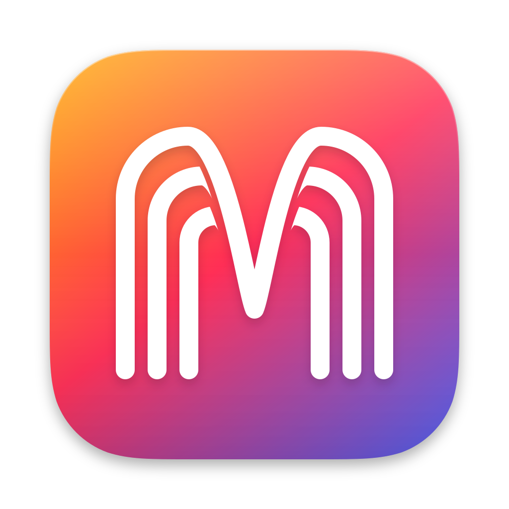
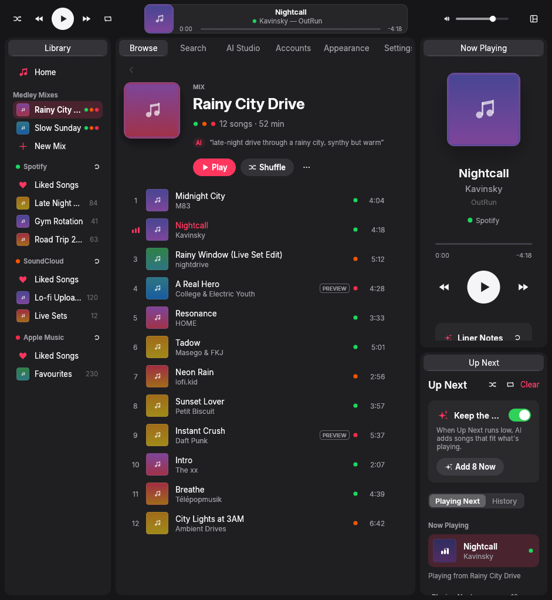
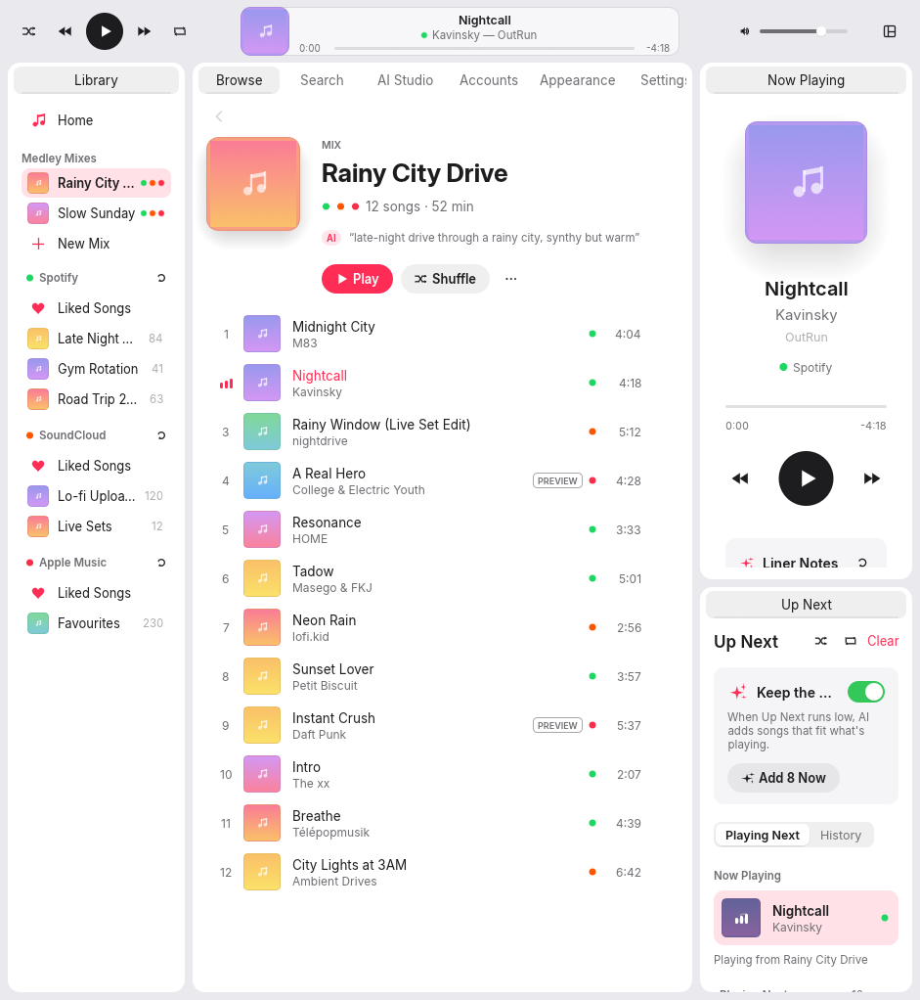
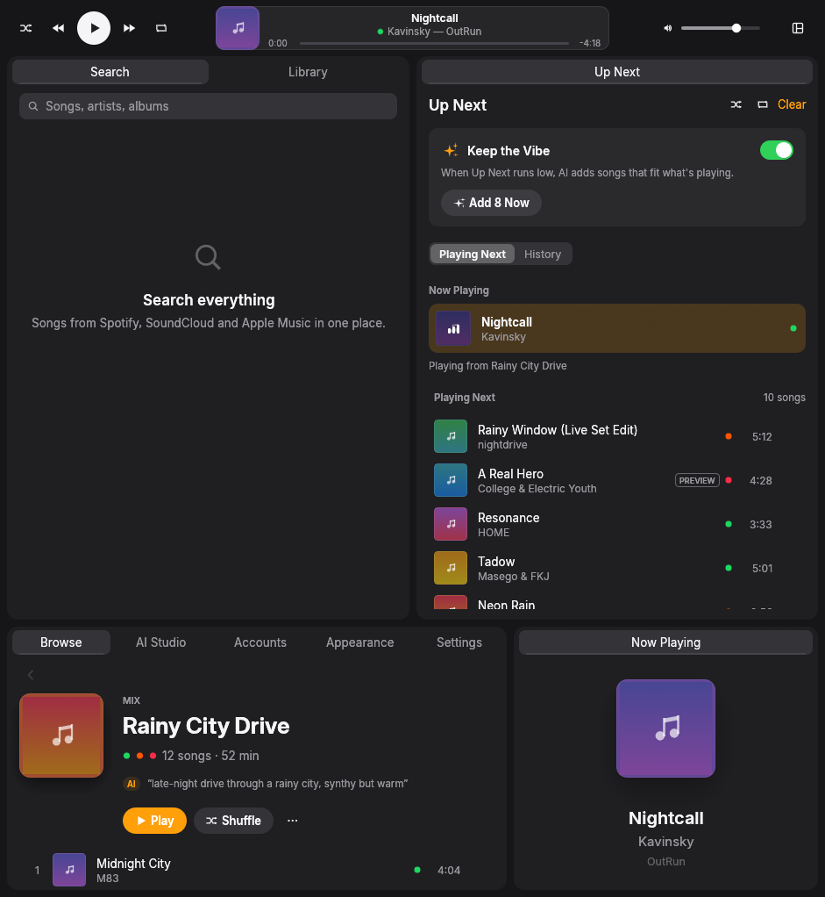
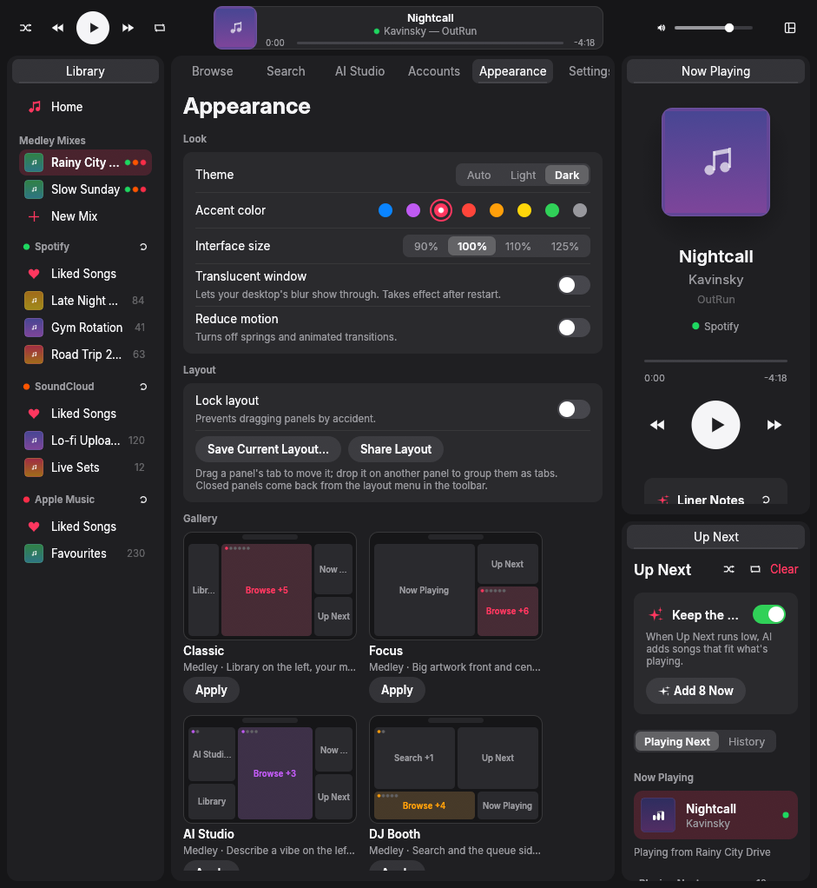
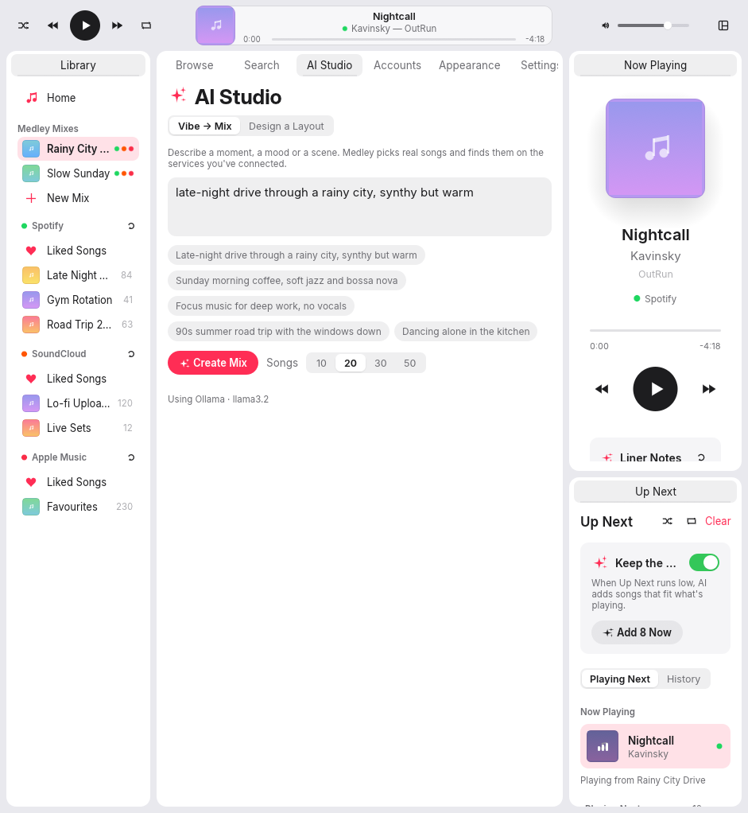

<p align="center">
  
</p>

<h1 align="center">Medley</h1>

<p align="center">
  <strong>One fast, native library for Spotify, SoundCloud and Apple Music.</strong>
</p>

<p align="center">
  <a href="https://github.com/martinkopoky-wq/medley/actions/workflows/ci.yml"></a>
  
  
</p>

---

Medley is a desktop music player written in Rust. Sign in to the services you use, and their libraries, playlists and search sit side by side in one window. Build **Mixes** that hold songs from all three at once, send a Mix to any service as a real playlist, and arrange the whole interface by dragging panels wherever you want them.

<p align="center">
  
  
</p>

## Why

The official Spotify desktop app is built on the Chromium Embedded Framework: a full browser engine to show a track list. Medley is a native app with no web view at all.

- **Draws only when it has to.** The UI is [egui](https://github.com/emilk/egui) in reactive mode: it redraws on input, and while music plays it wakes a few times a second for the progress bar. Otherwise it sleeps.
- **Releases the sound card.** The audio output device opens on first play and closes after 30 seconds of silence, so an idle Medley costs no audio CPU.
- **Keeps streams out of RAM.** Downloaded audio is buffered in an unlinked temp file, not a growing `Vec`, so a two-hour DJ set lives in the page cache instead of resident memory.
- **Lets go of artwork.** List rows load small cover images, and their textures are dropped after they've been off screen for a while.
- **Plays Spotify natively.** Spotify audio comes from [librespot](https://github.com/librespot-org/librespot), the same engine behind spotifyd and ncspot. SoundCloud and Apple Music previews are decoded with [symphonia](https://github.com/pdeljanov/Symphonia) through [rodio](https://github.com/RustAudio/rodio).

## Features

### One library, three services

- **Search everywhere** — one search field, results from every connected service.
- **Mixes** — cross-platform playlists that live in Medley. A single Mix can hold Spotify, SoundCloud and Apple Music tracks; each song plays from the service it came from.
- **Send a Mix anywhere** — export any Mix to Spotify, SoundCloud or Apple Music as a real playlist. Songs are matched by ISRC first, then by a fuzzy title/artist/duration match that ignores noise like "Remastered 2011" or "feat.", and Medley tells you which songs it couldn't find.
- **Your existing library** — liked songs and playlists from every account, in one sidebar.

### Make it yours

- **Dockable panels** — Library, Search, Browse, Now Playing, Up Next, AI Studio, Accounts, Appearance and Settings are all panels. Drag them to split the window, stack them, or group them as tabs. Lock the layout once it's right.
- **Community layouts** — five presets ship with the app (Classic, Focus, AI Studio, DJ Booth, Compact). Share your arrangement as a small JSON file, import other people's, or browse the [gallery](community/layouts/README.md).
<p align="center">
  
  
  
</p>

- **Apple-style design** — Inter typography, continuous-corner surfaces, the eight macOS accent colors, light, dark or follow-the-system appearance, and a Reduce Motion switch.

### AI that stays out of the way

Every AI feature is a single, structured request. Run it locally with [Ollama](https://ollama.com) (the default) or use Claude through the Anthropic API.

| Feature | What it does |
| --- | --- |
| **Vibe → Mix** | Describe a mood ("rainy Sunday, slow jazz but nothing sleepy") and get a named, sequenced Mix of 5–50 real songs, found on your services. |
| **Keep the Vibe** | When the queue runs low, Medley suggests what should play next based on the last few songs, without repeating what's already queued. |
| **Liner Notes** | A short note about the song that's playing, plus one musical detail to listen for. It's told to describe the sound rather than invent facts it isn't sure of. |
| **Name this Mix** | Gives a hand-built Mix a name and a one-line description. |
| **Smooth the Flow** | Reorders a Mix (up to 150 songs) so energy and tempo move gradually from opener to closer. |
| **Describe a Layout** | "Big artwork on the left, queue under the track list" becomes a working panel layout. |

Song ideas are resolved against your connected services in your preferred order, and full-length streams win over 30-second previews.

## What each service can do

Medley talks to each service through its official API, with your own account. Some limits come from the services themselves:

| | Spotify | SoundCloud | Apple Music |
| --- | --- | --- | --- |
| **Sign-in** | Browser login (OAuth PKCE) | Browser login (OAuth 2.1 PKCE) | Apple ID via MusicKit JS on a local page |
| **You need** | A Spotify account. Optionally your own app's client ID. | Your own SoundCloud app: client ID **and** secret | An Apple Developer MusicKit key (`.p8`, Team ID, Key ID), or a developer token |
| **Search, library, playlists** | Yes | Yes | Yes |
| **Create playlists (export a Mix)** | Yes | Yes | Yes |
| **Playback** | Full tracks, **Spotify Premium required** (librespot) | Full tracks where the uploader allows off-platform playback; previews otherwise | **30-second previews only** — full songs are FairPlay-protected and play only in Apple's own apps. Medley offers *Open in Apple Music*. |
| **Notes** | Spotify's Web API returns at most 10 search results per page and restricts apps in development mode. If the built-in client ID runs into limits, register your own app. | SoundCloud's terms require crediting the uploader; Medley links every SoundCloud track back to its page. | Library and playlists work in full. Developer tokens minted from your key last 150 days. |

## Install

Download the Linux x86_64 AppImage from [Releases](https://github.com/martinkopoky-wq/medley/releases/latest), make it executable, and open it:

```sh
chmod +x Medley-*.AppImage
./Medley-*.AppImage
```

If your system cannot mount AppImages with FUSE, run `./Medley-*.AppImage --appimage-extract-and-run` instead. Spotify playback is included. Release archives are also available for Linux, macOS and Windows.

To build from source, follow the steps below. Building takes a few minutes.

### Requirements

- Rust **1.88** or newer (`rustup update stable`)
- Linux only: a C toolchain, `pkg-config` and the ALSA headers. Wayland, X11, xkbcommon and OpenGL are loaded at runtime and come with any desktop.

```sh
# Debian / Ubuntu
sudo apt install build-essential pkg-config libasound2-dev libwayland-dev libxkbcommon-dev libgl1-mesa-dev

# Fedora
sudo dnf install gcc pkgconf-pkg-config alsa-lib-devel wayland-devel libxkbcommon-devel mesa-libGL-devel

# Arch
sudo pacman -S base-devel alsa-lib wayland libxkbcommon
```

macOS and Windows need nothing beyond Rust (and the Xcode command-line tools or the MSVC build tools).

### Build and run

```sh
git clone https://github.com/martinkopoky-wq/medley.git
cd medley
cargo run --release
```

The binary ends up in `target/release/medley`. On Linux, [`packaging/linux/app.medley.Medley.desktop`](packaging/linux/app.medley.Medley.desktop) and [`assets/icon-256.png`](assets/icon-256.png) give you a launcher entry:

```sh
install -Dm755 target/release/medley ~/.local/bin/medley
install -Dm644 packaging/linux/app.medley.Medley.desktop ~/.local/share/applications/app.medley.Medley.desktop
install -Dm644 assets/icon-256.png ~/.local/share/icons/hicolor/256x256/apps/app.medley.Medley.png
```

To build without Spotify playback (and without librespot), use `cargo build --release --no-default-features`.

To package your Linux x86_64 build as an AppImage:

```sh
cargo build --release --locked
bash packaging/linux/appimage.sh
```

The AppImage and its SHA-256 checksum appear in `dist/`. The script downloads checksum-verified packaging tools into `target/appimage/`. Official AppImages are built on Ubuntu 22.04 and require glibc 2.35 or newer plus a working Linux desktop. The tag-triggered release workflow builds, tests and publishes the AppImage automatically.

## Connecting your services

All sign-ins happen in your normal browser and redirect back to a tiny server Medley runs on `127.0.0.1` for the duration of the login. It listens on loopback only, checks the request's `state` nonce, and shuts down after the first valid answer or five minutes. The ports can be changed in `settings.json`.

| Service | Redirect URI | Default port |
| --- | --- | --- |
| Spotify | `http://127.0.0.1:8898/login` | 8898 |
| SoundCloud | `http://127.0.0.1:8899/soundcloud/callback` | 8899 |
| Apple Music | sign-in page at `http://127.0.0.1:8900/apple` | 8900 |

**Spotify.** Open **Accounts** and choose **Connect**. Medley uses librespot's client ID by default, so there's nothing to register. If you'd rather use your own app, create one at [developer.spotify.com](https://developer.spotify.com/dashboard), add the redirect URI above, and paste its client ID into Accounts. Playback needs Premium; browsing and playlists don't. Streaming quality is 96, 160 or 320 kbps (320 by default).

If connecting returns **429**, Spotify has limited the app's Web API access. With the built-in Client ID, that limit is shared with other users of the same ID. Set your own app's Client ID in Accounts and reconnect to obtain tokens for that app. Respect any reported wait time. `QUOTA_EXCEEDED` means the development app's quota is exhausted; reconnecting does not reset it. Development apps require their owner to have Premium and additional users to be allowlisted in the Spotify dashboard.

**SoundCloud.** Register an app at [soundcloud.com/you/apps](https://soundcloud.com/you/apps), add the redirect URI above, then paste the client ID and client secret into Accounts and connect.

**Apple Music.** Requires an [Apple Developer Program](https://developer.apple.com/programs/) membership. Create a MusicKit key, then either enter your Team ID, Key ID and the path to the `.p8` file (Medley mints and renews the developer token itself) or paste a developer token. **Connect** opens a local page that loads Apple's MusicKit JS; sign in with your Apple ID and the page hands the Music User Token back to Medley.

## Setting up AI

Pick a backend in **Settings**.

- **Ollama (default, local).** Install [Ollama](https://ollama.com), then `ollama pull llama3.2`. Medley talks to `http://127.0.0.1:11434`; both the URL and the model are configurable. Nothing leaves your machine.
- **Claude.** Add an Anthropic API key in Settings, or set `ANTHROPIC_API_KEY` in the environment. The default model is `claude-opus-5-5` at `medium` effort; both can be changed. Requests use structured JSON output, and on models that support it, Anthropic's server-side fallback answers if a request is declined.
- **Off.** Turns the AI features off; their buttons explain why they're unavailable.

AI features send your prompt and the titles and artists of the songs involved (the current song, your recent queue, or the Mix) to the backend you chose. Nothing else from your library or accounts is sent.

## Where your data lives

Medley keeps everything in small JSON files in the standard per-user folders:

| | Linux | macOS | Windows |
| --- | --- | --- | --- |
| Settings & credentials | `~/.config/medley/` | `~/Library/Application Support/app.Medley.medley/` | `%APPDATA%\Medley\medley\config\` |
| Mixes, layouts, panel arrangement | `~/.local/share/medley/` | `~/Library/Application Support/app.Medley.medley/` | `%APPDATA%\Medley\medley\data\` |
| Cache (stream buffers, librespot) | `~/.cache/medley/` | `~/Library/Caches/app.Medley.medley/` | `%LOCALAPPDATA%\Medley\medley\cache\` |

| File | Contents |
| --- | --- |
| `settings.json` | Preferences: services, AI backend, appearance, volume |
| `credentials.json` | OAuth tokens, the SoundCloud client secret, Apple tokens and the Anthropic API key. Written with `0600` permissions on Unix. |
| `mixes.json` | Your Mixes |
| `dock.json` | The current panel arrangement |
| `layouts/` | Saved and imported layouts |

Every write goes to a temp file first and is renamed into place, so a crash can't leave a half-written file behind. Credentials are stored as plain JSON protected by file permissions, not in the OS keychain. librespot also caches reusable Spotify credentials under the cache folder. To sign out everywhere, disconnect each service in Accounts or delete these folders.

## How it's built

Medley is a Cargo workspace of five crates:

```
                 ┌──────────────────────────────────────────────┐
                 │                    medley                    │
                 │  eframe/egui app · egui_dock panels · queue  │
                 │      layouts · background tasks (tokio)      │
                 └───────┬────────────────┬───────────────┬─────┘
                         │                │               │
          ┌──────────────▼───┐  ┌─────────▼────────┐  ┌───▼──────────────┐
          │ medley-providers │  │   medley-audio   │  │    medley-ai     │
          │ Spotify Web API  │  │ librespot        │  │ Ollama / Claude  │
          │ SoundCloud API   │  │ rodio/symphonia  │  │ structured JSON  │
          │ Apple Music API  │  │ HTTP + HLS       │  │ song resolution  │
          └──────────────┬───┘  └─────────┬────────┘  └───┬──────────────┘
                         └────────────────┼───────────────┘
                 ┌────────────────────────▼─────────────────────┐
                 │                 medley-core                  │
                 │  models · Provider trait · settings & creds  │
                 │  OAuth PKCE · song matching · layout format  │
                 └──────────────────────────────────────────────┘
```

| Crate | Responsibility |
| --- | --- |
| `medley-core` | Track/playlist/Mix models, the `Provider` trait, settings and credential storage, OAuth PKCE with the loopback server, cross-service song matching, and the layout format |
| `medley-providers` | Spotify, SoundCloud and Apple Music, each implementing `Provider` |
| `medley-audio` | The playback engine: librespot for Spotify, rodio/symphonia for HTTP and HLS streams, the file-backed stream buffer, and the idle output-device release |
| `medley-ai` | The AI features, both backends, and resolving song ideas to playable tracks |
| `medley` | The desktop app |

## Contributing

Bug reports, layouts and pull requests are welcome. [CONTRIBUTING.md](CONTRIBUTING.md) covers building, testing and adding a new service. Layout submissions are explained in [community/layouts](community/layouts/README.md).

## License

Licensed under either of [Apache License, Version 2.0](LICENSE-APACHE) or [MIT license](LICENSE-MIT), at your option. Unless you explicitly state otherwise, any contribution you submit for inclusion in Medley shall be dual licensed as above, without any additional terms or conditions.

The bundled [Inter](https://rsms.me/inter/) fonts are licensed under the SIL Open Font License ([assets/fonts/Inter-LICENSE.txt](assets/fonts/Inter-LICENSE.txt)).

## Disclaimer

Medley is an independent project. It is not affiliated with, endorsed by, or sponsored by Spotify, SoundCloud or Apple. Spotify, SoundCloud and Apple Music are trademarks of their respective owners. You are responsible for using each service in line with its terms; Medley only accesses accounts you sign in to yourself and plays content through the access those services grant.
